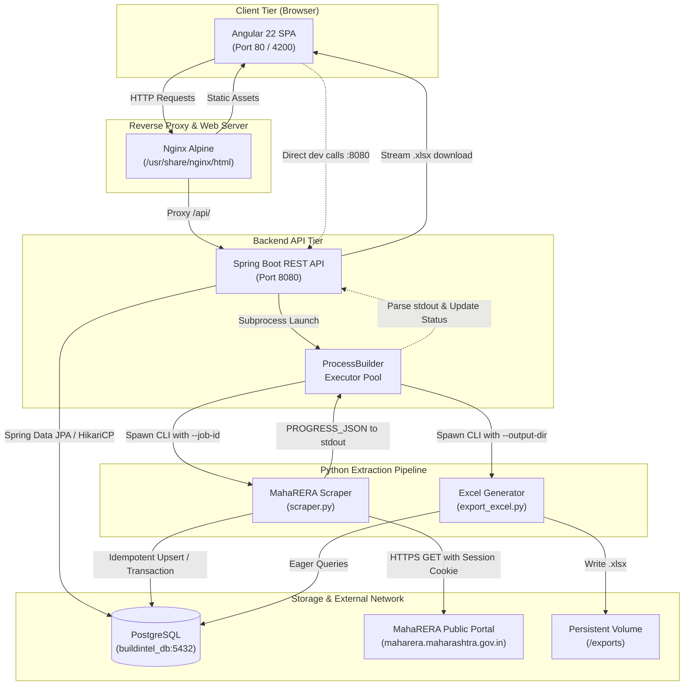

# BuildIntel — MahaRERA Real-Estate Intelligence Platform

BuildIntel is an enterprise-grade real-estate data collection, monitoring, and exploration platform designed to scrape, structure, and analyze publicly registered developments from the **Maharashtra Real Estate Regulatory Authority (MahaRERA)**.

It provides a modern **Angular** single-page application, a high-throughput **Spring Boot** REST API, an idempotent **Python / BeautifulSoup** data extraction pipeline, and a **PostgreSQL** relational database.

---

## Table of Contents

1. [Project Overview](#1-project-overview)
2. [Problem Statement](#2-problem-statement)
3. [Features](#3-features)
4. [Technologies Used](#4-technologies-used)
5. [Architecture Diagram](#5-architecture-diagram)
6. [Actual Repository Structure](#6-actual-repository-structure)
7. [Prerequisites](#7-prerequisites)
8. [Docker Installation](#8-docker-installation)
9. [Manual Installation](#9-manual-installation)
10. [Environment Configuration](#10-environment-configuration)
11. [Database Setup](#11-database-setup)
12. [Backend Setup](#12-backend-setup)
13. [Python Scraper Setup](#13-python-scraper-setup)
14. [Frontend Setup](#14-frontend-setup)
15. [Scraping Workflow](#15-scraping-workflow)
16. [API Documentation](#16-api-documentation)
17. [Excel Export](#17-excel-export)
18. [Testing Instructions](#18-testing-instructions)
19. [Troubleshooting](#19-troubleshooting)
20. [Known Limitations](#20-known-limitations)
21. [Security Notes](#21-security-notes)
22. [Project Screenshots](#22-project-screenshots)

---

## 1. Project Overview

BuildIntel enables researchers, real-estate analysts, and investors to systematically collect, query, and monitor property developments registered across all 36 districts of Maharashtra.

The platform bridges the gap between unstructured, slow public government search portals and structured relational intelligence. Users can dispatch automated scraping jobs, monitor page-by-page progress in real time, explore developer portfolios, search projects with server-side pagination, and export formatted multi-tab Microsoft Excel workbooks for offline due diligence.

---

## 2. Problem Statement

The official MahaRERA public search portal suffers from operational bottlenecks:
* **Slow Response Times & Fragile Sessions**: Heavy server load often results in HTTP timeouts and broken search sessions.
* **No Server-Side Postal Code Filter**: Users cannot isolate projects by pincode directly on the government server.
* **Limited Exploration & Analytics**: Lacks multi-parameter filtering, builder portfolio aggregation, and district-level inventory counts.
* **Absence of Bulk Analytical Exports**: Operators cannot easily export curated subsets into structured spreadsheets with verified hyperlinks.

BuildIntel addresses each issue through polite, throttled data extraction, transactional PostgreSQL upserts, real-time telemetry streaming, and a responsive web interface.

---

## 3. Features

* **Targeted Web Extraction**: Scrape listings by district (all 37 portal codes mapped), optional pincode filter, page bounds, and record caps.
* **Idempotent Ingestion Modes**:
  * `upsert`: Updates existing projects when portal data changes while inserting newly discovered filings.
  * `new_only`: Discards already collected registration numbers to minimize database writes.
* **Live Telemetry & Logs**: Asynchronous subprocess tracking displaying live pages processed, insert/update/skip counts, and activity stream.
* **Developer Directory**: Builder entity deduplication with reverse portfolio lookup linking parent developers to all registered projects.
* **District Intelligence Dashboard**: Real-time KPI summaries including total projects, active builders, completed scraping jobs, and district distributions.
* **Enterprise Excel Exporter**: Generates multi-tab workbooks (`.xlsx`) with frozen headers, auto-fitted columns, clickable MahaRERA detail hyperlinks, and builder rosters.
* **Universal Deployment**: Runs natively via single-command Docker Compose orchestration or standalone manual installation on Windows, Linux, and macOS.

---

## 4. Technologies Used

| Tier | Component | Technology | Version | Purpose |
| :--- | :--- | :--- | :--- | :--- |
| **Frontend** | Single Page App | Angular | 22.2.0 | Modern component architecture, signals, reactive state |
| | Build System | Angular CLI / Vite | 22.2.3 | Application bundling, TypeScript compilation |
| | HTTP & Reactive | RxJS | 7.8.0 | Asynchronous data streams, polling intervals |
| | Reverse Proxy | Nginx Alpine | 1.25+ | Static file serving and `/api` reverse proxy in Docker |
| **Backend** | Application Framework| Spring Boot | 4.1.2 | Enterprise REST API and process orchestration |
| | Runtime | Java JDK | 25 LTS (or 21+) | Modern JVM runtime, virtual threads support |
| | ORM & Persistence | Spring Data JPA / Hibernate | 7.4.13 | Relational entity mapping with query optimization |
| | Connection Pool | HikariCP | Built-in | High-performance JDBC connection pooling |
| **Scraper** | Extraction Engine | Python | 3.11 – 3.14 | HTML parsing, session negotiation, and data cleaning |
| | HTTP Client | Requests | 2.31+ | Cookie management, headers rotation, exponential retries |
| | HTML Parser | BeautifulSoup4 / lxml | 4.12+ | Extraction of project cards, dates, and filing links |
| | Database Ingestion | SQLAlchemy & Psycopg 3 | 2.0+ / 3.2+ | Transactional batch upserts and schema management |
| | Spreadsheet Engine | OpenPyXL / Pandas | 3.1+ / 2.2+ | Styled Excel workbook generation with hyperlinks |
| **Database** | Relational Store | PostgreSQL | 15, 16, 17 | ACID transactions, foreign keys, and indexed queries |
| **DevOps** | Containerization | Docker & Docker Compose | Multi-stage | Isolated container images and declarative network stack |

---

## 5. Architecture Diagram



---

## 6. Actual Repository Structure

```
Rera Scrapper/
├── .dockerignore                            # Exclusions for Docker build context
├── .env.example                             # Comprehensive root environment template
├── .gitignore                               # Production Git exclusions (credentials, caches, bins)
├── docker-compose.yml                       # Multi-container orchestration (Postgres, Backend, Frontend)
├── package-release.ps1                      # Release packaging script (creates clean ZIP archive)
├── requirements.txt                         # Python scraper and export dependencies
├── README.md                                # Comprehensive platform documentation
│
├── Backend/                                 # Spring Boot REST API
│   ├── Dockerfile                           # Multi-stage Dockerfile (Java 25 + Python 3 runtime)
│   ├── mvnw / mvnw.cmd                      # Maven Wrapper executables
│   ├── pom.xml                              # Maven build descriptor (Java 25, Spring Boot 4.1.2)
│   ├── .mvn/wrapper/                        # Maven wrapper configuration
│   └── src/
│       ├── main/
│       │   ├── java/com/buildintel/backend/
│       │   │   ├── BackendApplication.java  # Main application entry point
│       │   │   ├── config/WebConfig.java    # Centralized CORS and MVC configurations
│       │   │   ├── controller/              # Controllers (Project, Builder, Scraper, Dashboard, Export)
│       │   │   ├── dto/                     # Request and Response Data Transfer Objects
│       │   │   ├── entity/                  # JPA Entities (Builder, Project, ScrapingJob)
│       │   │   ├── exception/               # GlobalExceptionHandler and custom exceptions
│       │   │   ├── repository/              # Spring Data JPA Repositories
│       │   │   └── service/                 # Services (ScraperService, PythonEnvironmentService, etc.)
│       │   └── resources/
│       │       └── application.properties   # Spring Boot application properties
│       └── test/java/com/buildintel/backend/
│           ├── BackendApplicationTests.java # Context loading test
│           └── service/                     # Service-layer Mockito unit tests (21 tests total)
│
├── Frontend/                                # Angular 22 Single Page Application
│   ├── .dockerignore                        # Docker build context exclusions for Frontend
│   ├── angular.json                         # Angular CLI build configurations
│   ├── Dockerfile                           # Multi-stage Dockerfile (Node 24 build -> Nginx Alpine)
│   ├── nginx.conf                           # Nginx routing and /api reverse proxy configuration
│   ├── package.json / package-lock.json     # NPM dependencies and lockfile
│   ├── tsconfig.json / tsconfig.app.json    # TypeScript compilation configurations
│   └── src/
│       ├── environments/                    # Environment configs (development vs production)
│       ├── app/
│       │   ├── core/                        # Models and HTTP singleton services
│       │   ├── features/                    # Feature views (dashboard, projects, builders, scraper, export)
│       │   ├── layout/                      # Header and Sidebar navigation components
│       │   └── shared/                      # Reusable components (icons, pagination, loading states)
│       └── styles.css                       # Design tokens, color system, and layout styles
│
├── Scrapper/                                # Python Scraping Pipeline & Data Ingestion
│   ├── .env.example                         # Scraper-specific local environment template
│   ├── database.py                          # SQLAlchemy engine and session factory
│   ├── models.py                            # SQLAlchemy ORM models matching database schema
│   ├── scraper.py                           # MahaRERA crawler and CLI entry point
│   ├── export_excel.py                      # Multi-tab styled Excel generator
│   ├── main.py                              # Schema verification and standalone test script
│   └── test_scraper.py                      # Scraper parsing and district unit tests (12 tests)
│
├── database/                                # Database Initialization & Migrations
│   └── init.sql                             # PostgreSQL DDL schema (tables, constraints, indexes)
│
└── exports/                                 # Destination for generated Excel workbooks
    └── .gitkeep                             # Preserves directory in version control
```

---

## 7. Prerequisites

Before running BuildIntel manually without Docker, verify the following runtimes on your system:

| Runtime / Tool | Minimum Version | Verified Version | Verification Command |
| :--- | :--- | :--- | :--- |
| **Java JDK** | 21+ | 25.0.3 LTS | `java -version` |
| **Apache Maven** | 3.8+ | 3.9.16 | `mvn -version` |
| **Python** | 3.11+ | 3.14.4 | `python --version` |
| **Node.js** | 20.x or 22.x | 24.15.0 | `node -v` |
| **NPM** | 10.x+ | 11.12.1 | `npm -v` |
| **Angular CLI** | 20+ | 22.2.3 | `npx ng version` |
| **PostgreSQL** | 15+ | 16 / 17 | `psql --version` |

*For Docker-based setup, only **Docker Engine 24+** and **Docker Compose v2+** are required.*

---

## 8. Docker Installation

The fastest, recommended method to deploy the complete BuildIntel platform is via Docker Compose.

### Step 1: Clone or Extract Repository
```bash
git clone https://github.com/<your-username>/buildintel.git
cd buildintel
```

### Step 2: Configure Environment
Copy `.env.example` to `.env`:
```bash
# Windows PowerShell:
Copy-Item .env.example .env

# Linux / macOS:
cp .env.example .env
```
*(Optional)* Edit `.env` to customize your database password or host port mappings:
```ini
DB_PASSWORD=your_super_secret_password
FRONTEND_PORT=80
BACKEND_PORT=8080
```

### Step 3: Build and Start Containers
```bash
docker compose up --build -d
```

### Step 4: Verify Container Health
```bash
docker compose ps
```
All three containers (`buildintel-postgres`, `buildintel-backend`, `buildintel-frontend`) will report `healthy`.

### Step 5: Access the Application
* **Frontend Web UI**: [http://localhost](http://localhost) (or `http://localhost:<FRONTEND_PORT>`)
* **Backend REST API**: [http://localhost:8080/api](http://localhost:8080/api)
* **PostgreSQL Database**: `localhost:5432` (database: `buildintel_db`, user: `postgres`)

### Stopping the Stack
```bash
# Stop containers (preserves database and exports volumes)
docker compose down

# Stop and purge volumes (destroys database data)
docker compose down -v
```

---

## 9. Manual Installation

Follow these steps to run BuildIntel natively on Windows without Docker.

### Execution Flow Summary
1. Start PostgreSQL and execute `database/init.sql`.
2. Configure `.env` in the project root.
3. Set up the Python virtual environment and install `requirements.txt`.
4. Compile and launch the Spring Boot backend on port 8080.
5. Install NPM dependencies and start the Angular frontend on port 4200.

---

## 10. Environment Configuration

BuildIntel utilizes a centralized `.env` file loaded at application runtime.

| Variable | Purpose | Default | Required | Docker Usage |
| :--- | :--- | :--- | :--- | :--- |
| `DB_HOST` | PostgreSQL hostname or IP | `localhost` | **Yes** | Set to `postgres` |
| `DB_PORT` | PostgreSQL listening port | `5432` | **Yes** | Default `5432` |
| `DB_NAME` | Database schema name | `buildintel_db` | **Yes** | Default `buildintel_db` |
| `DB_USER` | Database role username | `postgres` | **Yes** | Default `postgres` |
| `DB_PASSWORD` | PostgreSQL authentication password | `your_secure_password_here`| **Yes** | Injected from `.env` |
| `SERVER_PORT` | Spring Boot HTTP port | `8080` | No | Default `8080` |
| `BACKEND_PORT` | Host port mapped to Spring Boot | `8080` | No | Host port forwarding |
| `FRONTEND_PORT`| Host port mapped to Nginx/Angular | `80` | No | Host port forwarding |
| `CORS_ALLOWED_ORIGINS` | Permitted browser origins | `http://localhost,http://localhost:80,http://localhost:4200,http://127.0.0.1:4200` | No | Spring WebConfig |
| `PYTHON_EXECUTABLE` | Explicit path to Python binary | *(Auto-detected)* | No | Set to `/app/venv/bin/python` |
| `SCRAPER_SCRIPT_PATH` | Path to `scraper.py` | *(Auto-detected)* | No | Set to `/app/Scrapper/scraper.py` |
| `EXPORT_SCRIPT_PATH` | Path to `export_excel.py` | *(Auto-detected)* | No | Set to `/app/Scrapper/export_excel.py` |
| `EXPORTS_DIR` | Excel files output directory | *(Auto-detected)* | No | Set to `/app/exports` |

---

## 11. Database Setup

### 1. Create PostgreSQL Database
Launch your PostgreSQL management tool (`psql`, pgAdmin, or DBeaver):
```sql
CREATE DATABASE buildintel_db;
```

### 2. Initialize Schema
Run the provided SQL initialization script to create tables, constraints, and indexes:
```bash
# Using psql on Windows PowerShell:
psql -U postgres -d buildintel_db -f database/init.sql
```
*Alternatively, the schema can be verified and initialized via Python:*
```bash
python Scrapper/main.py
```

### 3. Verify Connectivity
Ensure PostgreSQL is listening on port 5432:
```powershell
Test-NetConnection -ComputerName localhost -Port 5432
```

---

## 12. Backend Setup

The Spring Boot backend manages API endpoints, triggers Python subprocesses, and tracks job progress.

### 1. Build and Run Tests
```bash
cd Backend
mvn test
```
*Expected: 21 tests pass with 0 failures.*

### 2. Start the Backend Server
Pass database credentials via environment variables or allow Spring Boot to read `.env`:
```powershell
# In Windows PowerShell:
$env:DB_HOST="localhost"
$env:DB_PORT="5432"
$env:DB_NAME="buildintel_db"
$env:DB_USER="postgres"
$env:DB_PASSWORD="your_actual_password"

mvn spring-boot:run
```
The server will initialize HikariCP connection pools and bind to **http://localhost:8080**.

---

## 13. Python Scraper Setup

The scraping pipeline requires Python 3.11+ and dependencies from `requirements.txt`.

### 1. Create Virtual Environment
From the project root:
```powershell
# Create virtual environment
python -m venv venv

# Activate on Windows PowerShell:
.\venv\Scripts\Activate.ps1

# Upgrade pip and install packages
pip install --upgrade pip
pip install -r requirements.txt
```

### 2. Run Scraper Unit Tests
```powershell
python -m unittest Scrapper/test_scraper.py
```
*Expected: 12 unit tests pass in < 0.1 seconds.*

### 3. Standalone CLI Scraper Execution
The scraper can be invoked directly from the terminal without starting Spring Boot:
```powershell
# Scrape 1 page from Pune in upsert mode:
python Scrapper/scraper.py --district Pune --start-page 1 --max-pages 1 --mode upsert

# Scrape with post-scrape pincode filter:
python Scrapper/scraper.py --district Nagpur --start-page 1 --max-pages 2 --pincode 441108
```

---

## 14. Frontend Setup

The Angular client provides a reactive dashboard, project search, developer profiles, and job controls.

### 1. Install Dependencies
```bash
cd Frontend
npm ci
```

### 2. Verify API Configuration
* **Development mode** (`Frontend/src/environments/environment.development.ts`): points to `http://localhost:8080/api`.
* **Production mode** (`Frontend/src/environments/environment.ts`): points to `/api` (proxied via Nginx in Docker).

### 3. Start Development Server
```bash
npm start
```
Open **http://localhost:4200** in your browser.

### 4. Build Production Bundle
```bash
npm run build
```
Generates production artifacts in `Frontend/dist/buildintel-frontend/browser`.

---

## 15. Scraping Workflow

```
[ User UI ] ──(1) POST /api/scraper/start──> [ Spring Boot ]
                                                    │
                                             (2) Spawns Subprocess
                                                    ▼
                                           [ Python scraper.py ]
                                                    │
                                     (3) HTTP GET with delay & cookies
                                                    ▼
                                          [ MahaRERA Portal ]
                                                    │
                                      (4) Raw HTML Cards Returned
                                                    ▼
                                           [ HTML Card Parser ]
                                                    │
                                    (5) Idempotent SQL Upsert / Insert
                                                    ▼
                                            [ PostgreSQL ]
                                                    │
                                      (6) PROGRESS_JSON to stdout
                                                    ▼
                                            [ Spring Boot ]
                                                    │
[ User UI ] <──(7) Poll GET /status/{id} ───────────┘
```

1. **Parameter Dispatch**: The user selects a district (e.g. `Pune`), optional pincode, page range (`1..2`), and mode (`upsert`).
2. **Safety Check**: Spring Boot ensures only one job runs concurrently, returning `409 Conflict` if busy.
3. **Execution**: `ScraperService` executes `scraper.py` via Java `ProcessBuilder`.
4. **Session Handshake**: Python acquires a MahaRERA portal session cookie and requests search pages.
5. **Card Parsing & Deduplication**: Project listings are parsed; promoter names are mapped to `builders`, and projects are upserted into `projects`.
6. **Telemetry & Live Log Stream**: Python emits `PROGRESS_JSON:{...}` stdout events. Spring Boot streams and parses these metrics into the database and memory.
7. **Reactive UI Updates**: Angular polls the status endpoint every 2 seconds, displaying dynamic progress rings, speed counters, and logs.

---

## 16. API Documentation

Base URL: `http://localhost:8080/api` (or `/api` in Docker)

### Projects Endpoints

#### `GET /api/projects`
Retrieve paginated projects with optional sorting.
* **Query Parameters**: `page` (default 0), `size` (default 10), `sort` (default `id,asc`).
* **Response**: `200 OK` — `PaginatedResponse<ProjectResponseDTO>`.

#### `GET /api/projects/{id}`
Retrieve complete project details by primary key ID.
* **Response**: `200 OK` — `ProjectResponseDTO` (or `404 Not Found`).

#### `GET /api/projects/search`
Search projects by name or registration number.
* **Query Parameters**: `keyword` (string), `page` (int), `size` (int), `sort` (string).
* **Response**: `200 OK` — `PaginatedResponse<ProjectResponseDTO>`.

#### `GET /api/projects/filter`
Filter projects by district and/or pincode.
* **Query Parameters**: `district` (string), `pincode` (string), `page` (int), `size` (int).
* **Response**: `200 OK` — `PaginatedResponse<ProjectResponseDTO>`.

#### `GET /api/projects/builder/{builderId}`
Retrieve all projects associated with a given developer entity.
* **Response**: `200 OK` — `PaginatedResponse<ProjectResponseDTO>`.

---

### Builders Endpoints

#### `GET /api/builders`
Retrieve paginated list of developers with project counts.
* **Query Parameters**: `page` (default 0), `size` (default 10), `sort` (default `id,asc`).
* **Response**: `200 OK` — `PaginatedResponse<BuilderResponseDTO>`.

#### `GET /api/builders/{id}`
Retrieve developer details and their complete project portfolio.
* **Response**: `200 OK` — `BuilderDetailResponseDTO`.

---

### Scraper Control Endpoints

#### `POST /api/scraper/start`
Dispatch a new background scraping job.
* **Request Body**:
```json
{
  "district": "Pune",
  "districtCode": "521",
  "pincode": null,
  "startPage": 1,
  "maxPages": 2,
  "maxRecords": 0,
  "scrapeAll": false,
  "mode": "upsert"
}
```
* **Response**: `202 Accepted` — `ScrapingJobResponseDTO` with status `"QUEUED"`.

#### `GET /api/scraper/status/{jobId}`
Get live metrics, counters, and log output for a job.
* **Response**: `200 OK` — `ScrapingJobResponseDTO`.

#### `GET /api/scraper/active`
Retrieve currently running or queued job if present.
* **Response**: `200 OK` with job DTO, or `204 No Content` if idle.

#### `GET /api/scraper/jobs`
Retrieve paginated history of past scraping jobs.
* **Response**: `200 OK` — `PaginatedResponse<ScrapingJobResponseDTO>`.

#### `POST /api/scraper/cancel/{jobId}`
Terminate an in-flight scraper subprocess.
* **Response**: `200 OK` with status `"STOPPED"`.

#### `GET /api/scraper/districts`
List all 37 verified Maharashtra districts with live database project counts.
* **Response**: `200 OK` — `List<DistrictOptionDTO>`.

---

### Dashboard & Export Endpoints

#### `GET /api/dashboard/stats`
Retrieve high-level intelligence metrics (total projects, total builders, completed jobs, top districts).
* **Response**: `200 OK` — `DashboardStatsDTO`.

#### `GET /api/export/excel`
Generate and download a formatted Microsoft Excel spreadsheet.
* **Response**: Binary stream (`application/vnd.openxmlformats-officedocument.spreadsheetml.sheet`) with header `Content-Disposition: attachment; filename="BuildIntel_MahaRERA_YYYYMMDD_HHMMSS.xlsx"`.

---

## 17. Excel Export

The platform provides a dedicated Excel generation pipeline (`Scrapper/export_excel.py`) that exports database tables into formatted multi-sheet workbooks:

1. **Sheet 1: Projects**:
   * Columns: Registration Number, Project Name, Developer/Promoter Name, State, District, Pincode, Locality, Last Modified Date, MahaRERA Detail URL (clickable hyperlink), Application URL, Ingestion Date.
   * Formatting: Corporate Navy header (`#1e3a8a`), bold white typography, frozen header row, thin borders, and auto-adjusted column widths.
2. **Sheet 2: Promoters / Builders**:
   * Columns: Builder ID, Promoter Legal Name, Registration Number, Official Address.
   * Formatting: Standardized tabular format with auto-fitting.

Exports are generated on demand via `GET /api/export/excel` or from the Web UI under **Export Data**.

---

## 18. Testing Instructions

### 1. Spring Boot Backend Tests
```bash
cd Backend
mvn test
```
* **Scope**: 21 unit & context tests covering controller mappings, service logic, district conversions, error sanitization, and JPA queries.
* **Expected Result**: `BUILD SUCCESS (21 tests run, 0 failures, 0 errors)`.

### 2. Python Scraper Tests
```bash
cd Scrapper
python -m unittest test_scraper.py
```
* **Scope**: 12 unit tests verifying HTML card parsing, date parsing formats, district mapping resolution, and CLI parameter parsing.
* **Expected Result**: `Ran 12 tests ... OK`.

### 3. Python Syntax Compilation Check
```bash
python -m py_compile Scrapper/database.py Scrapper/models.py Scrapper/scraper.py Scrapper/export_excel.py Scrapper/main.py Scrapper/test_scraper.py
```
* **Expected Result**: Silent completion (zero syntax errors).

### 4. Angular Frontend Build Check
```bash
cd Frontend
npm run build
```
* **Scope**: TypeScript compilation, template type checking, production tree-shaking, and asset bundling.
* **Expected Result**: `Application bundle generation complete` within budget limits.

---

## 19. Troubleshooting

### 1. PostgreSQL Connection Refused / Authentication Failed
* **Symptom**: `PSQLException: Connection refused` or `password authentication failed`.
* **Remedy**:
  1. Verify the PostgreSQL service is active:
     ```powershell
     Get-Service -Name postgresql*
     ```
  2. Verify your credentials in `.env` match your PostgreSQL password.
  3. Ensure port 5432 is accepting connections:
     ```powershell
     Test-NetConnection -ComputerName localhost -Port 5432
     ```

### 2. Missing Database Tables (`ddl-auto=validate`)
* **Symptom**: `SchemaManagementException: Schema-validation: missing table [builders]`.
* **Remedy**: Spring Boot validates that tables exist. Initialize tables before launching the backend:
  ```bash
  psql -U postgres -d buildintel_db -f database/init.sql
  ```

### 3. Port Conflicts (Port 8080, 4200, or 80)
* **Symptom**: `Port 8080 was already in use` or `EADDRINUSE: 4200`.
* **Remedy**:
  * Find the blocking process:
    ```powershell
    Get-Process -Id (Get-NetTCPConnection -LocalPort 8080).OwningProcess | Stop-Process -Force
    ```
  * Or configure alternate ports in `.env`: `BACKEND_PORT=8081` or `FRONTEND_PORT=8081`.

### 4. Python Subprocess Not Found
* **Symptom**: `java.io.IOException: Cannot run program "python": CreateProcess error=2`.
* **Remedy**:
  * Ensure Python is added to your system `PATH`.
  * Or specify the absolute path in `.env`:
    ```ini
    PYTHON_EXECUTABLE=C:\Users\<user>\AppData\Local\Programs\Python\Python314\python.exe
    ```

### 5. MahaRERA Request Timeouts
* **Symptom**: `requests.exceptions.ReadTimeout` during scraping.
* **Remedy**: The public portal occasionally experiences slow response times. The scraper automatically retries with exponential backoff. Increase the per-request timeout via `--timeout 45`.

---

## 20. Known Limitations

1. **MahaRERA Server-Side Pincode Query**: The official MahaRERA search query does not support server-side pincode filtering. BuildIntel implements client-side post-scrape filtering on parsed HTML metadata.
2. **Politeness & Rate Limiting**: MahaRERA is a public government service. A default delay of 1.5 seconds between requests is enforced. Do not reduce this delay below 1.0s to avoid server throttling or IP blocking.
3. **Card Listings vs Deep Filing Attachments**: The scraper extracts structured metadata from public listing cards (names, promoters, addresses, dates, status, filing links). Downloading individual PDF attachments or encumbrance certificates requires deep scraping through the extracted detail URLs.
4. **Historical District Renaming**: Maharashtra renamed Aurangabad to Chhatrapati Sambhaji Nagar and Osmanabad to Dharashiv. BuildIntel maintains backwards-compatible dual mappings (e.g. 525 and 992) to support both historical records and new portal entries.

---

## 21. Security Notes

* **No Hardcoded Secrets**: All passwords, database URLs, and API tokens are externalized into environment variables.
* **Version Control Hygiene**: `.env` and local database dumps are strictly ignored by `.gitignore` and `.dockerignore`.
* **Path Sanitization**: Exception handling masks local file system paths (e.g. `C:\Users\...` or `/var/www/...`) before returning error messages to the client.
* **CORS Restrictions**: Spring Boot enforces explicit allowed origins configured via `CORS_ALLOWED_ORIGINS`.
* **Docker Isolation**: Containers communicate over an internal bridge network (`buildintel-network`). In production deployments, PostgreSQL does not need to expose port 5432 to the public internet.

---

## 22. Project Screenshots

Below are placeholders representing the primary views of the BuildIntel platform:

### 1. Intelligence Dashboard
*Visual overview of total projects, registered builders, completed jobs, and district distributions.*
```
+------------------------------------------------------------------------------------+
|  BuildIntel Dashboard                                               [ Export Data ]|
|  Total Projects: 1,420    Total Builders: 890    Jobs Run: 14    Last Scraped: 2h  |
|                                                                                    |
|  [ Top Districts by Project Count ]                                                |
|  * Pune: 450 projects          * Mumbai Suburban: 380 projects                     |
|  * Thane: 290 projects         * Nagpur: 150 projects                              |
+------------------------------------------------------------------------------------+
```

### 2. Interactive Scraper Control Panel
*Targeted job configuration, safety modal, and live progress streaming.*
```
+------------------------------------------------------------------------------------+
|  Scraper Control                                                                   |
|  District: [ Pune (521)        v ]   Pincode: [ 411001   ]   Mode: (o) Upsert      |
|  Page Range: [ 1 ] to [ 5 ]          Delay: 1.5s             ( ) New Only          |
|  [ Start Scraping Job ]                                                            |
|                                                                                    |
|  [ Live Telemetry ] Status: RUNNING                                                |
|  Processed Pages: 3 / 5 | Discovered: 30 | Inserted: 12 | Updated: 4 | Skipped: 14 |
|  Activity Log:                                                                     |
|  [10:15:02] Page 2 parsed: +6 new, ~2 updated, =2 skipped                          |
+------------------------------------------------------------------------------------+
```

### 3. Projects Directory & Advanced Search
*Searchable table with pagination, district filters, and direct MahaRERA filing links.*
```
+------------------------------------------------------------------------------------+
|  Projects Directory                                                                |
|  Search: [ Keyword...        ]  District: [ All Districts v ]                      |
|  Reg Number    Project Name          Builder             District    Status        |
|  P52100001234  Riverfront Residency  Skyline Developers  Pune        Registered    |
|  P51800005678  Ocean View Tower      Apex Realty Group   Mumbai Sub  Registered    |
|  Showing 1 - 10 of 1,420 projects                            < 1 [2] 3 4 5 >       |
+------------------------------------------------------------------------------------+
```

### 4. Excel Export Center
*One-click multi-tab Microsoft Excel (.xlsx) workbook generation with formatted columns and hyperlinks.*
```
+------------------------------------------------------------------------------------+
|  Export Project Data                                                               |
|  [ Download MahaRERA Dataset (.xlsx) ]                                             |
|  Includes:                                                                         |
|  - Sheet 1: Projects (Registration, Name, Builder, Dates, Clickable Filing URLs)   |
|  - Sheet 2: Promoters / Builders (Entity ID, Legal Name, Address)                  |
+------------------------------------------------------------------------------------+
```

---

## License

This project is prepared for professional software evaluation, technical review, and educational portfolio purposes. Real-estate data is sourced from public records on the official MahaRERA portal.
